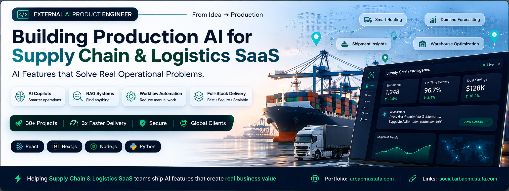

  

<h1 align="center">Hi, I'm Arbab 👋</h1>

<h3 align="center">
External AI Product Engineer for Supply Chain & Logistics SaaS
</h3>

I'm a full-stack engineer who enjoys building software that solves real operational problems.

Over the past few years, I've worked across React, Next.js, Node.js, Python, PostgreSQL, and cloud technologies to build SaaS applications from idea to production.

Lately, my focus has shifted toward AI.

I'm particularly interested in building AI features that fit naturally into existing products—things like AI copilots, RAG-powered search, workflow automation, and internal tools that help teams work faster instead of adding more complexity.

Right now I'm focused on Supply Chain & Logistics SaaS, where I believe AI can remove a lot of repetitive work and improve day-to-day operations.

Most of the projects here are things I've built while learning, experimenting, or solving real problems. I'm always trying to make them cleaner, faster, and more production-ready.

---

### Tech I use regularly

- React
- Next.js
- Node.js
- TypeScript
- Python
- FastAPI
- PostgreSQL
- MongoDB
- Docker
- Azure
- OpenAI
- LangChain
- LangGraph

---

### Currently working on

- AI Copilots
- RAG Applications
- Workflow Automation
- Production AI Features
- Supply Chain & Logistics Software

---

### Let's connect

🌐 Portfolio: https://arbabmustafa.com

🔗 Links: https://social.arbabmustafa.com

💼 LinkedIn: https://linkedin.com/in/arbabmustafa
